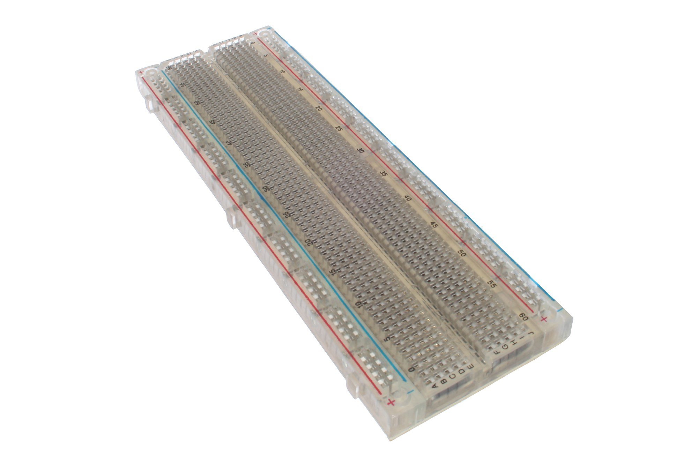
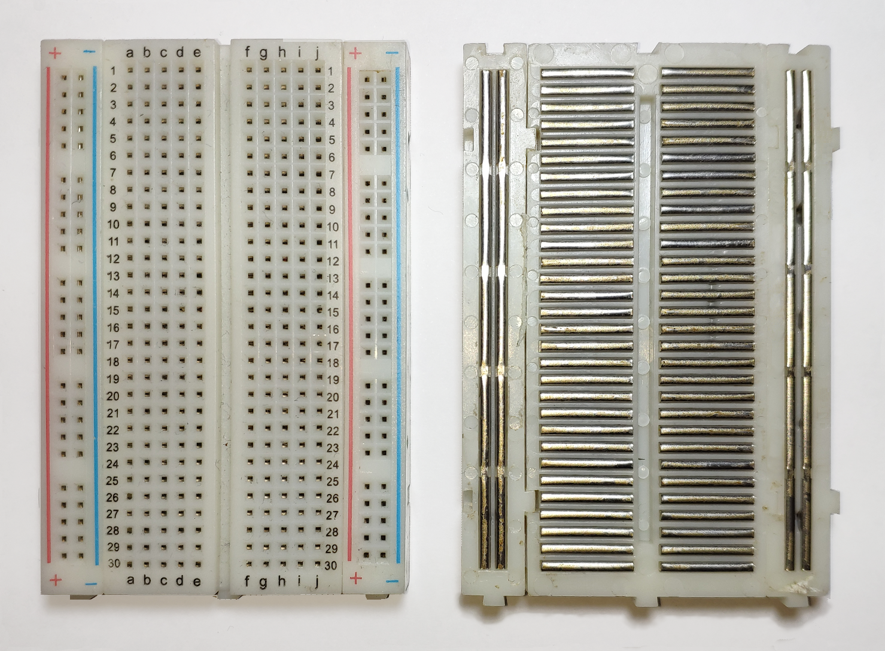
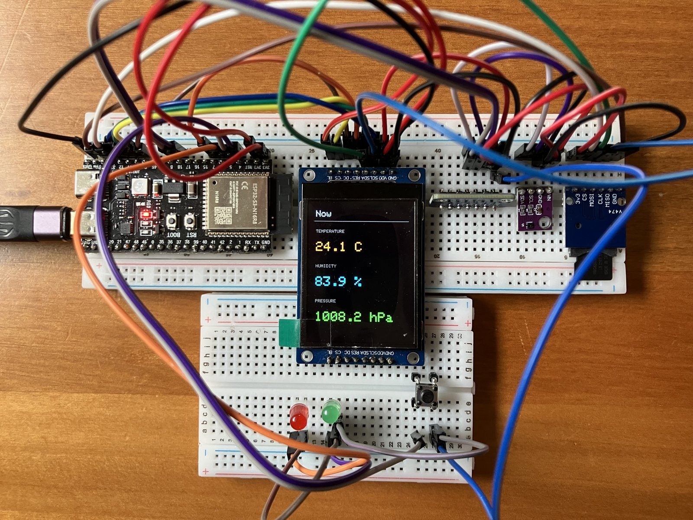

# Hardware reference

## Parts

| Role | Part | Notes |
|------|------|-------|
| MCU | ESP32-S3 DevKitC-1 class | Dual Type-C N16R8 |
| Temp / humidity | **SHT40** | I2C (spares on hand); power silk **VCC** / **VIN** / **VN** |
| Pressure | **BMP390** | I2C (spares on hand); power silk **VCC** / **VIN** |
| Display | **Estardyn 2.0″ ST7789** | 240×320, 8-pin SPI, **BL** on header |
| Storage | TF / microSD mini reader | 3V3 **6-pin SPI** breakout (Temu pack) — Phase 8 |
| Breadboard | Solderless **830** | Full-size; one or two (tie rail gaps if split) |
| Jumpers | DuPont | M–M for board↔board / board↔rail |

v1 uses **one SHT40 + one BMP390**. Confirm silk and I2C addresses in Phase 4 (typical: SHT40 `0x44`, BMP390 `0x76`/`0x77`). No lux sensor on the bench yet.

!!! note "TFT silk — this Estardyn panel"
    Header, left→right: `GND` · `VDD` · `SCK` · `SDA` · `RES` · `DC` · `CS` · `BL`.

    - Confirm **4-SPI** (silk **R3** + **R5**).
    - Some packs print **`SCL`** for the clock — same net as **`SCK`**.
    - **RES** and **RST** are the same reset pin.
    - Phase 2 ties **BL → 3V3**; the backlight needs no GPIO.

---

## Breadboard

Nothing is "wired" yet — the board already has metal clips under the holes. This lab uses a full-size **830**-point board.

*An empty 830 board — rows and rails are already tied as below.*

*Top and underside: the same net rules apply across any 830 board.*

| Region | How holes are tied (factory default) |
|--------|--------------------------------------|
| Terminal strips | Each **row** of five (`a–e` or `f–j`) is one net. Same-number left and right are **not** joined. |
| Power rails | The `+` column is one vertical net; the `−` column is another. Red/`+` → **3V3**, blue/`−` → **GND** in this lab. |
| Rail gaps | Many boards break each rail halfway. Bridge with a short jumper if needed. |

Pick one `+` rail and one `−` rail as the 3V3/GND star. Run S3 **3V3** and **GND** into those rails once, then tap modules from the rails.

<small>Credit: empty 830 board [oomlout / BREB-02](https://commons.wikimedia.org/wiki/File:BREB-02_(14335226011).jpg) (CC BY-SA 2.0); connections diagram [Guhuru](https://commons.wikimedia.org/wiki/File:Breadboard.png) (CC0).</small>

---

## One board or two

By Phase 9 this bench spilled onto a **second breadboard** — the top 830 holds the S3, display and sensors; a lower board carries the tact switch and status LEDs with room to spare.

*Two boards by Phase 9 — but a single 830 fits the whole build if you keep leads tidy. Tact cycles [Now / Session / System](phases/09-views.md).*

The board count doesn't matter. What matters is that every net lands where the [pin map](#pin-map) says:

- One **3V3** rail and one **GND** rail shared across both boards — jumper rail-to-rail so the second board sees the same star.
- Each module's pin on the GPIO the pin map lists — verified by **label**, not by which board it sits on.

Split onto a second board only when the jumper nest gets hard to read.

---

## Pin map

As-built through Phase 9. Match every connection by **label**.

    ESP32-S3          SHT40          BMP390              ST7789
    --------          -----          ------              ------
    3V3        -----> VCC/VIN/VN --> VCC/VIN             VDD, (BL)
    GND        -----> GND     -----> GND                 GND
    GPIO8      -----> SDA     -----> SDI (I2C data)
    GPIO18     -----> SCL     -----> SCK (I2C clock)
    GPIO11     ---------------------------------------> SDA (MOSI)
    GPIO12     ---------------------------------------> SCK (SPI clock; silk may say SCL)
    GPIO10     ---------------------------------------> CS
    GPIO9      ---------------------------------------> DC
    GPIO7      ---------------------------------------> RES/RST
    3V3        ---------------------------------------> BL (Phase 2)
    3V3        ---------------------------------------> SD 3V3
    GPIO13     ---------------------------------------> SD CS
    GPIO11     ---------------------------------------> SD MOSI  (shared with TFT)
    GPIO12     ---------------------------------------> SD CLK   (shared with TFT SCK)
    GPIO14     ---------------------------------------> SD MISO
    GND        ---------------------------------------> SD GND
    GPIO5      ---------------------------------------> tact (other leg GND)
    GPIO4      ---------------------------------------> green LED (+R) -> GND
    GPIO6      ---------------------------------------> red LED (+R) -> GND

**Sensors (I2C).** BMP390: leave **CS** / **SDO** open for I2C; the data pin silk may say **SDI** or **SDA**.

**microSD (Phase 8).** This bench 6-pin silk: **`3V3 CS MOSI CLK MISO GND`** (zeros may stand in for O). Share **CLK/MOSI** with the TFT; **MISO = GPIO14**, **CS = GPIO13**. Power from **3V3** only. Never share CS with the display (GPIO10).

**Controls (Phase 9).** Tact on **GPIO5** (`INPUT_PULLUP`, other leg to GND). Green LED **GPIO4**, red LED **GPIO6**, each through a series resistor. No buzzer in v1.

---

## Rules

- Modules are **3V3** — never feed 5V into sensor or TFT logic.
- Do **not** join TFT MOSI to I2C SDA.
- Avoid GPIO **0 / 19 / 20 / 38 / 48 / 45 / 46** (and **35–37** on Octal PSRAM).
- S3 underside silk is mirrored vs top — match by **label**.

---

## Asset index

| File | What |
|------|------|
| `assets/breadboard-empty.jpg` | Empty full-size **830** breadboard |
| `assets/breadboard-connections.png` | Top + underside clips (same net rules on 830) |
| `assets/esp32s3-board-top.png` | S3 board photo |
| `assets/wiring-phase2-tft.svg` | Phase 2 TFT power (schematic) |
| `assets/wiring-phase3-sensors.svg` | Phase 3 SHT40 + BMP390 power (schematic) |
| `assets/wiring-phase4-i2c.svg` | Phase 4 I2C SDA/SCL (schematic) |
| `assets/wiring-phase6-tft.svg` | Phase 6 TFT SPI (schematic) |
| `assets/ui-phase7-climate.svg` | Phase 7 Climate UI mock (ST7789) |
| `assets/wiring-phase8-sd.svg` | Phase 8 microSD SPI (schematic) |
| `assets/wiring-phase9-controls.svg` | Phase 9 tact + status LEDs |
| `assets/bench-phase9-now.jpg` | Phase 9 — Now view |
| `assets/bench-phase9-session.jpg` | Phase 9 — Session (min/now/max) |
| `assets/bench-phase9-system.jpg` | Phase 9 — System (SD / sensors / append) |
