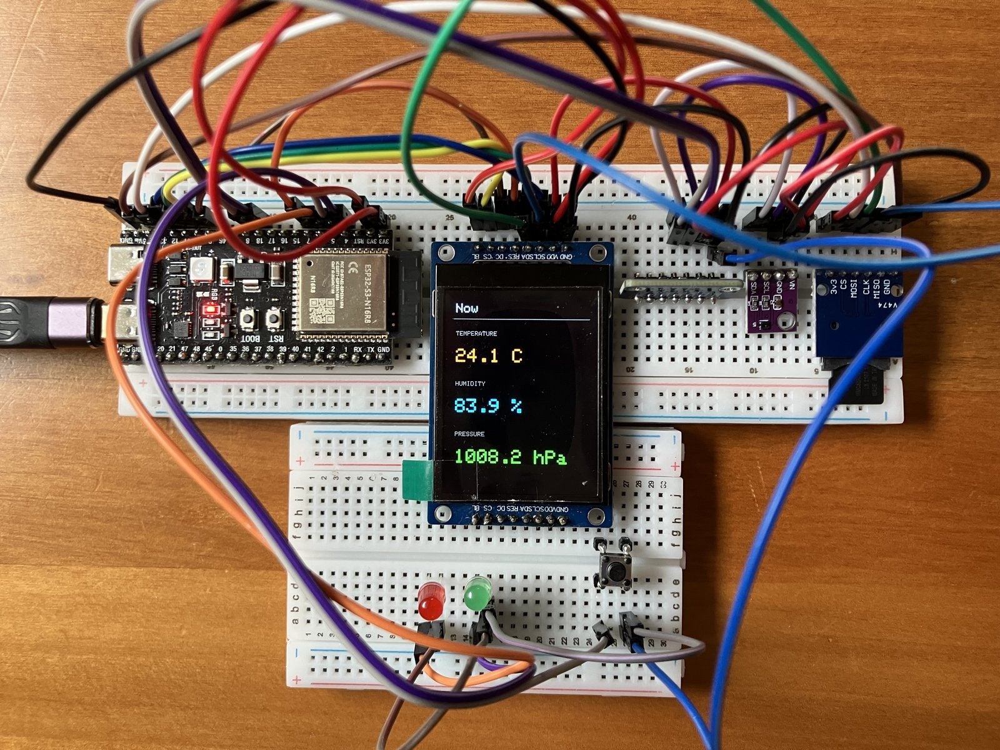
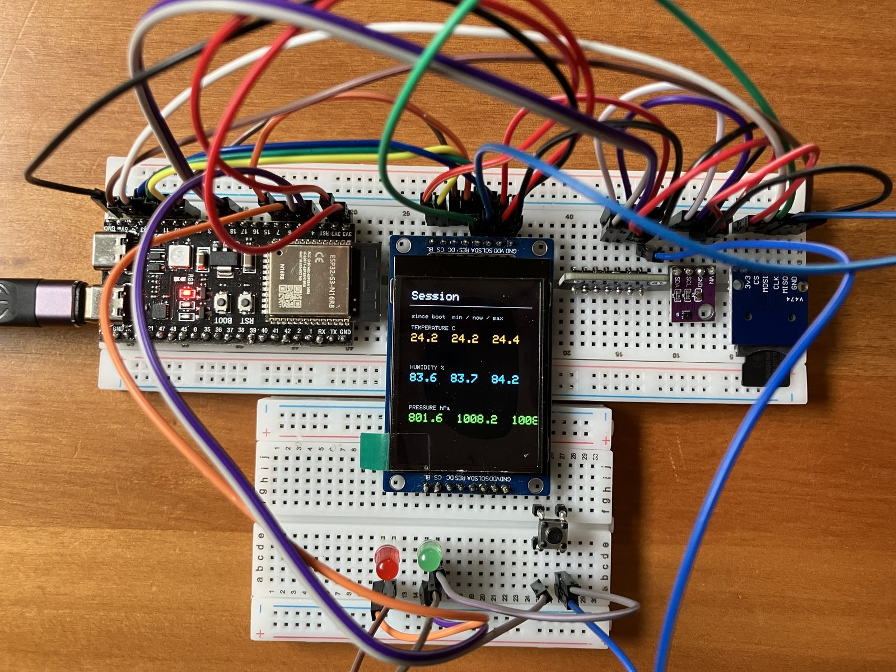
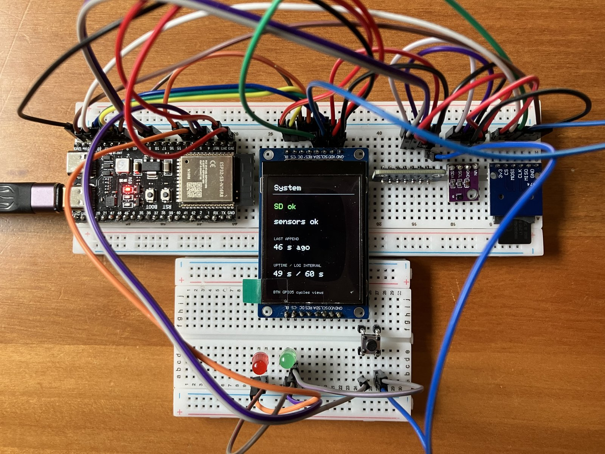
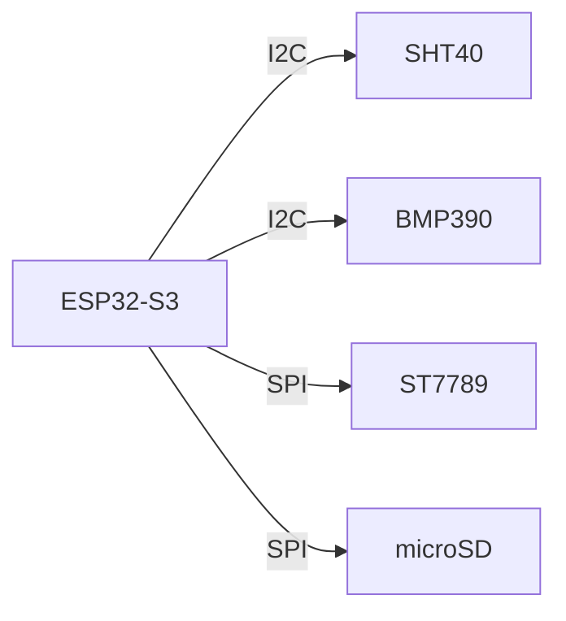
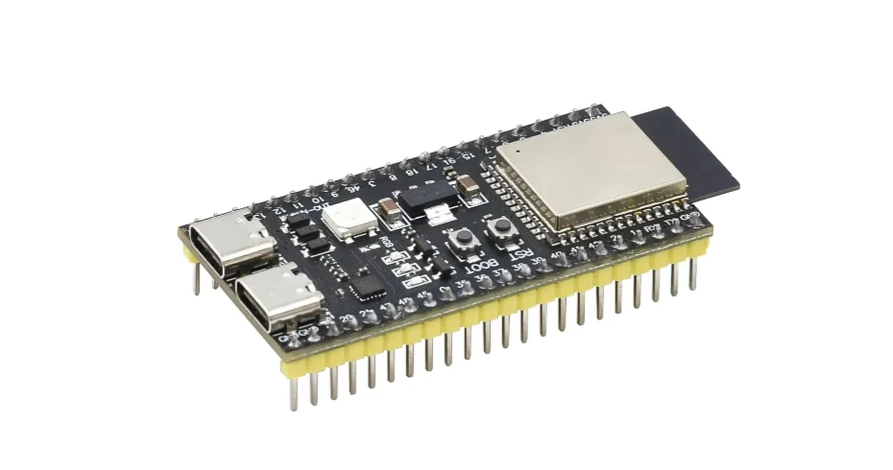

# ESP32-S3 weather station

A desk climate station you wire yourself. Temperature, humidity and pressure show live on a TFT and log to a microSD card as CSV. Local only — no cloud, no fleet.

*The finished bench on **Now**: live temperature, humidity and pressure. One tact press moves to Session, another to System, then back to Now.*

---

## What you build

Three screens on the ST7789, cycled with one tact on **GPIO5**:

| Screen | Shows |
|--------|-------|
| **Now** | Live temperature, humidity, pressure |
| **Session** | min / now / max since boot |
| **System** | SD health, sensor status, last append, uptime |

*Now — the default view after boot.*

*Session — first press. Tracks the range since power-on (breathe on the SHT40 and the max humidity climbs).*

*System — second press. Confirms the card (`SD ok`), sensors, last CSV append age, and the log interval (60 s here).*

Alongside the display: a `climate.csv` on the card that grows every logging interval, a green LED that blinks on each write, and a red LED that latches on a fault.

---

## How it fits together

The S3 reads the SHT40 and BMP390 over I2C, and drives the TFT and microSD reader over SPI. Everything runs on 3V3 across one or two solderless breadboards. Pin-level wiring is on the [Hardware](hardware.md) page.

*The brain: an ESP32-S3 N16R8, dual Type-C, 16MB flash, 8MB PSRAM.*

---

## Start here

Runs on Ubuntu 24.04. Work the phases in order — each is a frozen `firmware/<nn>-…/` snapshot with its own walkthrough and a single checkpoint to pass before the next.

| Doc | Role |
|-----|------|
| [Prerequisites](prerequisites.md) | Install the tools. Assume nothing. |
| [Hardware](hardware.md) | Parts, pin map, wiring |
| [Firmware](firmware.md) | Per-phase `firmware/<nn>-…/` folders |
| [Lab log](lab-log.md) | Bench scoreboard — what passed, what didn't |

---

## Phases

| Phase | Goal |
|-------|------|
| [0 — USB erase](phases/00-usb-erase.md) | Detect the board, confirm N16R8, wipe flash |
| [1 — Hello flash](phases/01-hello-flash.md) | First firmware, serial output |
| [2 — TFT power](phases/02-tft-power.md) | Power the display, backlight on |
| [3 — Sensor power](phases/03-sensor-power.md) | Power the SHT40 and BMP390 |
| [4 — I2C scan](phases/04-i2c-scan.md) | Find both sensors on the bus |
| [5 — Climate read](phases/05-climate-read.md) | Temperature, humidity and pressure on serial |
| [6 — TFT fill](phases/06-tft-fill.md) | Wire SPI, prove the panel with colour fills |
| [7 — Climate UI](phases/07-climate-ui.md) | Live readings on the TFT |
| [8 — SD log](phases/08-sd-log.md) | Append CSV samples to microSD |
| [9 — TFT views](phases/09-views.md) | Tact cycles Now / Session / System; status LEDs |

Current status lives in the [lab log](lab-log.md).

!!! note "Indoor climate first"
    v1 is a sheltered desk logger: SHT40 + BMP390, live TFT views, CSV on microSD, tact + status LEDs. Buzzer, lux, rain and wind stay out of scope until you add those parts.
