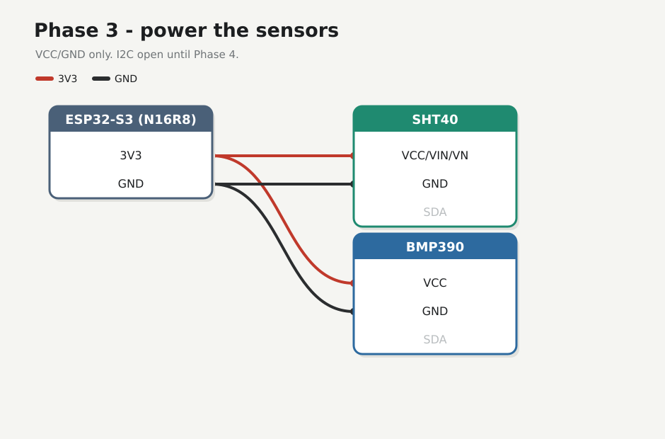

# Phase 3 — Power the sensors

Four wires: **SHT40** and **BMP390** supply only. TFT power from Phase 2 stays. No I2C data yet.

## Firmware

**Unchanged** — [`firmware/01-hello/`](../../firmware/01-hello/).

## Preconditions

[Checkpoint 2](02-tft-power.md) passed. One SHT40 and one BMP390 on the breadboard. Unplug USB while seating jumpers.

!!! warning
    Power the modules from **3V3 only** — 5V on the logic can kill them. After wiring, check for heat and ~3.3 V on each VCC before trusting it.

---

## Wires



| From S3 | To |
|---------|-----|
| **3V3** | SHT40 **VCC** / **VIN** / **VN**, BMP390 **VCC** / **VIN** |
| **GND** | SHT40 **GND**, BMP390 **GND** |

Tap the breadboard **3V3 / GND** star ([how the board is tied](../hardware.md#breadboard)) — don’t daisy-chain module-to-module for power. Silk may say **VCC**, **VIN**, **VN**, or **3Vo** — same 3V3 rail as TFT **VDD**. Leave **SDA** / **SCL** open until Phase 4.

---

## Check

Plug COM. Modules cool. Meter ≈ 3.3 V on each sensor VCC. TFT backlight still on. Hello still prints.

<div class="run" markdown>

```bash
pio device monitor -b 115200 --port /dev/ttyACM0
```

```text {.no-copy}
weather hello MAC=28:84:85:8C:D0:40 uptime_ms=1624
```

</div>

## Checkpoint 3

- [x] Those four sensor power wires only (TFT power still on)
- [x] ~3.3 V on each VCC, no heat
- [x] Hello still prints
- [x] [Lab log](../lab-log.md)

**Next:** [Phase 4 — I2C scan](04-i2c-scan.md)
