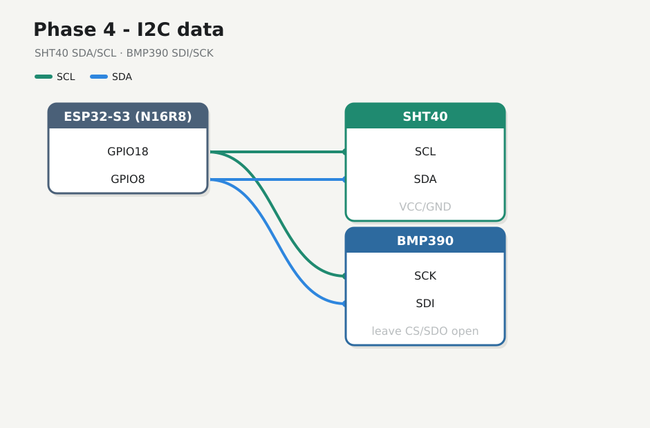

# Phase 4 — Wire I2C + scan

Add **SDA** / **SCL** and confirm **SHT40** and **BMP390** answer on the bus. Power from Phases 2–3 stays on.

## Firmware

**Changed.** New folder [`firmware/04-i2c-scan/`](../../firmware/04-i2c-scan/). Do not edit `01-hello`. Pins `SDA=8` `SCL=18`.

## Preconditions

- [Checkpoint 3](03-sensor-power.md) passed
- Sensor **VCC/GND** already on the 3V3 star
- Unplug USB while seating the two data jumpers

---

## 4.1 Data wires



| S3 | SHT40 | BMP390 (I2C silk) |
|----|-------|----------------------|
| **GPIO8** | **SDA** | **SDI** (sometimes labeled **SDA**) |
| **GPIO18** | **SCL** | **SCK** |

BMP390 breakouts usually don’t print `SCL`/`SDA` — they reuse SPI names. For I2C: **SCK = clock**, **SDI = data**. Leave BMP390 **CS** and **SDO** open ([Adafruit pinouts](https://learn.adafruit.com/adafruit-bmp388-bmp390-bmp3xx/pinouts)).

**Both wires or nothing** — one alone → `found none`. Do not wire TFT SPI yet.

---

## 4.2 Flash scanner

Stop any serial monitor on COM first.

<div class="run" markdown>

```bash
cd firmware/04-i2c-scan
pio run -e esp32-s3-n16r8 -t upload --upload-port /dev/ttyACM0
```

```text {.no-copy}
Connected to ESP32-S3 on /dev/ttyACM0:
…
Hash of data verified.
Hard resetting via RTS pin...
========================= [SUCCESS] Took 13.70 seconds =========================
```

</div>

<div class="run" markdown>

```bash
pio device monitor -b 115200 --port /dev/ttyACM0
```

```text {.no-copy}
weather i2c-scan — phase 4
SDA=GPIO8 SCL=GPIO18 expect=SHT40~0x44 BMP390~0x76/0x77
--- i2c scan ---
found 0x44
found 0x77
devices=2
```

</div>

Expect **0x44** (SHT40) and **0x76** or **0x77** (BMP390) every scan. This bench: **0x44** + **0x77**, stable. Note any other addresses as ghosts.

## 4.3 If no device

- Confirm both data wires seated on **each** module (BMP390: **SDI**+**SCK**, not CS/SDO)
- Recheck data/clock not swapped
- Shared GND confirmed on the star
- Shorter jumpers; power still ~3.3 V on each VCC

## Checkpoint 4

- [x] Serial scan lists SHT40 (~`0x44`) and BMP390 (~`0x76`/`0x77`)
- [x] Addresses stable across resets
- [x] Logged in [lab-log.md](../lab-log.md)

**Stop here until checkpoint passes.**

**Next:** [Phase 5 — Climate read](05-climate-read.md)
