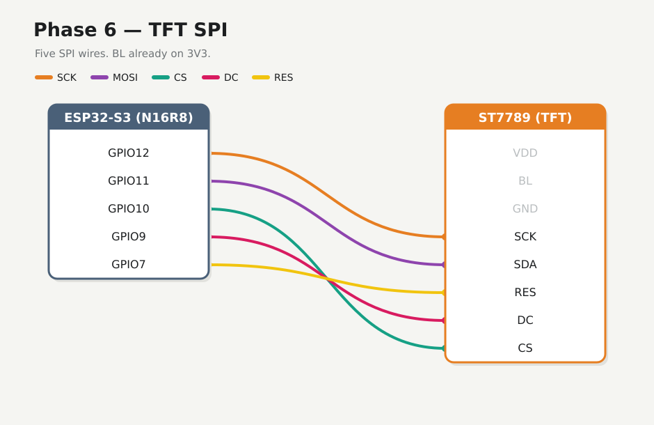

# Phase 6 — Wire TFT SPI + fill screen

Add five SPI wires and prove the panel draws. Power (Phase 2) and sensor I2C (Phases 3–5) stay on. **BL** is already on **3V3** — no new backlight wire.

## Firmware

**Changed.** New folder [`firmware/06-tft-fill/`](../../firmware/06-tft-fill/).

## Preconditions

- [Checkpoint 5](05-climate-read.md) passed
- Unplug USB while seating SPI jumpers

---

## 6.1 SPI wires



| S3 | TFT |
|----|-----|
| **GPIO12** | **SCK** (SPI clock; some packs print **SCL**) |
| **GPIO11** | **SDA** (MOSI) |
| **GPIO10** | **CS** |
| **GPIO9** | **DC** |
| **GPIO7** | **RES** / **RST** (same pin) |

This bench Estardyn prints **`SCK`** (not `SCL`) for SPI clock. Silk may say **RES** or **RST** — both are reset. Do **not** tie TFT **SDA** to sensor **SDA** (GPIO8). All five SPI wires or the panel stays blank.

---

## 6.2 Flash

Stop any serial monitor on COM first.

<div class="run" markdown>

```bash
cd firmware/06-tft-fill
pio run -e esp32-s3-n16r8 -t upload --upload-port /dev/ttyACM0
```

```text {.no-copy}
Connected to ESP32-S3 on /dev/ttyACM0:
…
Hash of data verified.
Hard resetting via RTS pin...
========================= [SUCCESS] Took 10.59 seconds =========================
```

</div>

<div class="run" markdown>

```bash
pio device monitor -b 115200 --port /dev/ttyACM0
```

```text {.no-copy}
weather tft-fill — phase 6
SPI SCK=12 MOSI=11 CS=10 DC=9 RST=7  BL=3V3(phase2)
I2C SHT40@0x44=ack BMP390@0x77=ack — buses coexist
cycling red -> green -> blue every 1 s
fill RED
fill GREEN
fill BLUE
```

</div>

This bench: panel cycles RGB; I2C still acks both sensors with SPI active.

Panel should cycle full-screen **red → green → blue**.

## 6.3 If blank

- Confirm 4-SPI jumpers on the module (silk R3+R5)
- BL still powered (Phase 2)
- CS/DC/RST not swapped
- All five SPI wires seated
- TFT SDA is **not** on the I2C SDA net

## Checkpoint 6

- [x] Visible full-screen color change on TFT
- [x] Serial shows I2C `ack` for SHT40 + BMP390 (buses coexist)
- [x] Logged in [lab-log.md](../lab-log.md)

**Stop here until checkpoint passes.**

**Next:** [Phase 7 — Climate UI](07-climate-ui.md)
