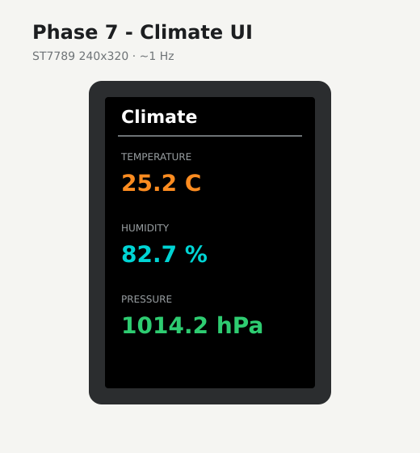

# Phase 7 — Climate UI

Live “now” screen on the ST7789: **SHT40** temperature/humidity + **BMP390** pressure. No new wires. Optional tact switch / LED / buzzer later.



| On screen | Source |
|-----------|--------|
| **Climate** title | chrome |
| Large orange `°C` | SHT40 temperature |
| Large cyan `%` | SHT40 relative humidity |
| Large green `hPa` | BMP390 pressure |
| Serial lines | same three values @ ~1 Hz |

## Firmware

**Changed.** New folder [`firmware/07-climate-ui/`](../../firmware/07-climate-ui/) · [`src/main.cpp`](../../firmware/07-climate-ui/src/main.cpp)

Estardyn 2.0″ bring-up (same as Phase 6):

```text
SPI.begin(SCK=12, MISO=-1, MOSI=11, SS=CS)
tft.init(240, 320);   // not 240x240
tft.setRotation(0);   // SPI_MODE0 default
```

## Preconditions

- [Checkpoint 6](06-tft-fill.md) passed (RGB fill visible)
- Phases 2–6 wiring still on (TFT power + SPI, sensor power + I2C)

---

## 7.1 Flash

Stop any serial monitor on COM first.

<div class="run" markdown>

```bash
cd firmware/07-climate-ui
pio run -e esp32-s3-n16r8 -t upload --upload-port /dev/ttyACM0
```

```text {.no-copy}
Connected to ESP32-S3 on /dev/ttyACM0:
…
Hash of data verified.
Hard resetting via RTS pin...
========================= [SUCCESS] Took 11.45 seconds =========================
```

</div>

<div class="run" markdown>

```bash
pio device monitor -b 115200 --port /dev/ttyACM0
```

```text {.no-copy}
weather climate-ui — phase 7
SDA=8 SCL=18  SPI SCK=12 MOSI=11 CS=10 DC=9 RST=7
UI live — ~1 Hz
temp_c=25.42  humidity=86.1  pressure_hpa=1010.30
temp_c=25.44  humidity=85.7  pressure_hpa=1010.30
temp_c=25.44  humidity=85.4  pressure_hpa=1010.32
```

</div>

This bench: serial streams ~25 °C / mid-80s % RH / ~1010 hPa @ ~1 Hz. TFT should show the **Climate** layout above with matching numbers (rounded).

---

## 7.2 Validate

1. TFT shows title + three labelled values (not a black/blank panel).
2. Numbers move when you breathe on the SHT40.
3. Serial `temp_c` / `humidity` / `pressure_hpa` match the screen within rounding.
4. No SPI/I2C fights (screen stays live; serial keeps printing).

---

## 7.3 If blank (serial OK)

Serial printing but a dark panel means SPI/backlight wiring or a bad init — not the climate sensors.

1. Confirm **BL** and **VDD** still on **3V3** (Phase 2).
2. Reseat all five SPI wires from [Phase 6](06-tft-fill.md): GPIO12→SCL, 11→SDA, 10→CS, 9→DC, 7→RES/RST.
3. TFT **SDA** must not share the I2C SDA net (GPIO8).
4. Module is **4-SPI** (silk R3+R5).
5. Do **not** flash `init(240, 240, SPI_MODE3)` — that blanks this Estardyn 240×320.
6. Fall back: flash [`firmware/06-tft-fill`](../../firmware/06-tft-fill/). If RGB still fails, fix wiring before retrying Phase 7.

---

## Checkpoint 7

- [x] Readable live climate screen on the TFT (see Phase 9 bench photo)
- [x] UI matches serial within rounding
- [x] Logged in [lab-log.md](../lab-log.md)

**Stop here until checkpoint passes.**

**Next:** [Phase 8 — SD log](08-sd-log.md)
