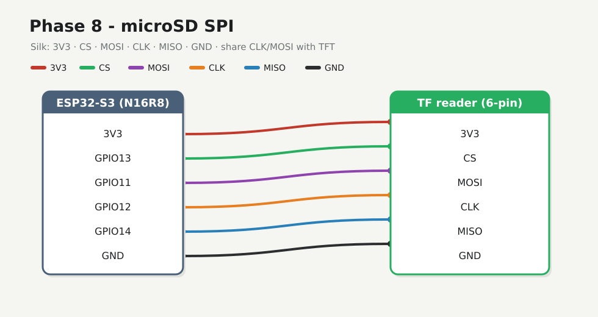

# Phase 8 — SD log

Append CSV samples to the **3V3 6-pin TF/SPI mini reader** while the Phase 7 climate UI keeps updating. Shared SPI clock/MOSI with the TFT; **dedicated SD CS** and **MISO**.

## Firmware

**Changed.** New folder [`firmware/08-sd-log/`](../../firmware/08-sd-log/) · [`src/main.cpp`](../../firmware/08-sd-log/src/main.cpp). Uses **SdFat** on the shared SPI bus (not the AVR `arduino-libraries/SD` package).

| Behaviour | Value |
|-----------|-------|
| TFT UI | same Climate screen @ ~1 Hz |
| CSV path | `/climate.csv` |
| Append interval | **60 s** (`LOG_PERIOD_MS` — raise toward `300000` for 5 min) |
| Timestamp | `uptime_ms` (no RTC in v1) |

## Preconditions

- [Checkpoint 7](07-climate-ui.md) passed (TFT live + serial match)
- microSD already **FAT32** on the host ([Prerequisites §4](../prerequisites.md#4-format-the-microsd-fat32)) — label `CLIMATE` on this bench
- Card seated in the Temu 6-pin reader
- Unplug USB while seating SD jumpers

---

## 8.1 SD wires



This bench silk (header order): **`3V3` · `CS` · `MOSI` · `CLK` · `MISO` · `GND`**. Some boards print **`M0SI` / `MIS0`** (zero for letter O).

| S3 | Module silk |
|----|-------------|
| **3V3** | **3V3** |
| **GPIO13** | **CS** |
| **GPIO11** | **MOSI** (already on TFT SDA) |
| **GPIO12** | **CLK** (same as SCK; already on TFT SCL) |
| **GPIO14** | **MISO** |
| **GND** | **GND** |

Match by **label**, not assumed left-to-right on a different pack. **Never** share CS with TFT **CS** (GPIO10). Power from **3V3** only.

---

## 8.2 Flash

Stop any serial monitor on COM first.

<div class="run" markdown>

```bash
cd firmware/08-sd-log
pio run -e esp32-s3-n16r8 -t upload --upload-port /dev/ttyACM0
```

```text {.no-copy}
Connected to ESP32-S3 on /dev/ttyACM0:
…
Hash of data verified.
Hard resetting via RTS pin...
========================= [SUCCESS] Took 19.44 seconds =========================
```

</div>

<div class="run" markdown>

```bash
pio device monitor -b 115200 --port /dev/ttyACM0
```

```text {.no-copy}
weather sd-log — phase 8
I2C SDA=8 SCL=18  TFT CS=10  SD CS=13 MISO=14
UI ~1 Hz; CSV append every 60 s -> /climate.csv
SD ready
UI live
temp_c=25.48  humidity=85.0  pressure_hpa=1010.28
sd append /climate.csv uptime_ms=1205
```

</div>

This bench: FAT32 card mounts; first CSV append right after boot, then about every 60 s.

### Example row

```text
uptime_ms,temp_c,humidity,pressure_hpa
60012,25.40,85.0,1010.30
```

---

## 8.3 Validate

1. TFT Climate UI still updates (~1 Hz).
2. Serial shows `SD ready`, then `sd append /climate.csv …` about once a minute.
3. Power down, pull the card, open `/climate.csv` on the host — header + growing rows.

---

## 8.4 If SD fails

- `SD begin failed` → reseat card; re-check **FAT32** on the host ([Prerequisites §4](../prerequisites.md#4-format-the-microsd-fat32)); CS is **GPIO13** not TFT CS
- Host reader shows **SIZE `0B`** → card not detected; try another card/reader before blaming SPI
- Reader stays cool on **3V3** (5V kills many modules)
- MISO must be **GPIO14** (TFT does not need MISO; the card does)
- Shared **CLK**/MOSI still seated to the TFT from Phase 6
- Try a shorter CS/MISO jumper; another card

UI-only without a card is OK for bring-up — fix the reader before calling the checkpoint done.

---

## Checkpoint 8

- [x] File `/climate.csv` grows while powered (`sd append` on serial)
- [ ] CSV opens cleanly on the host (header + rows) — pull card and confirm once
- [x] TFT UI still live with SPI shared (Phase 9 bench photo)
- [x] Logged in [lab-log.md](../lab-log.md)

**Stop here until checkpoint passes.**

**Next:** [Phase 9 — TFT views](09-views.md)
