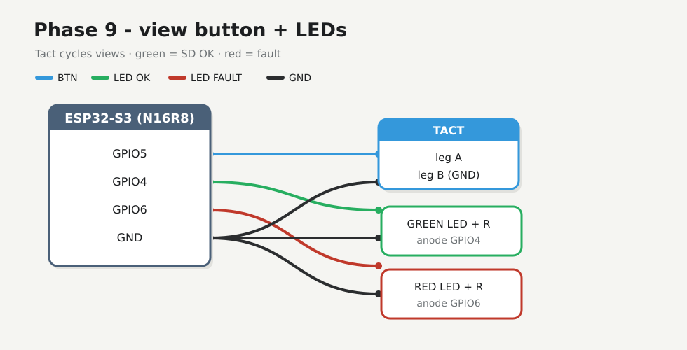
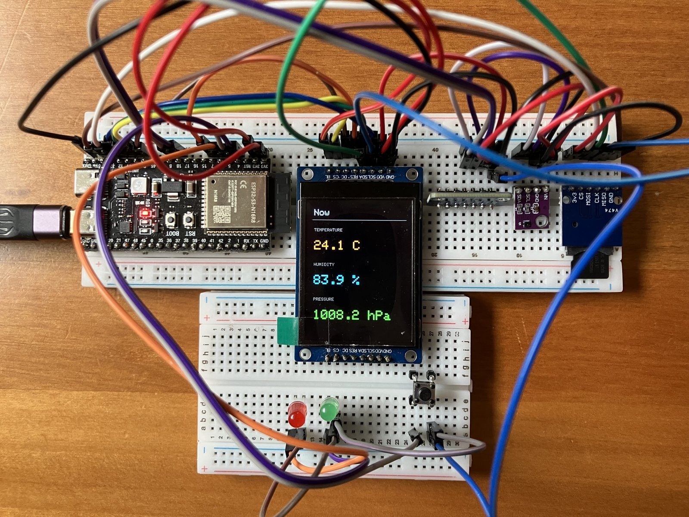
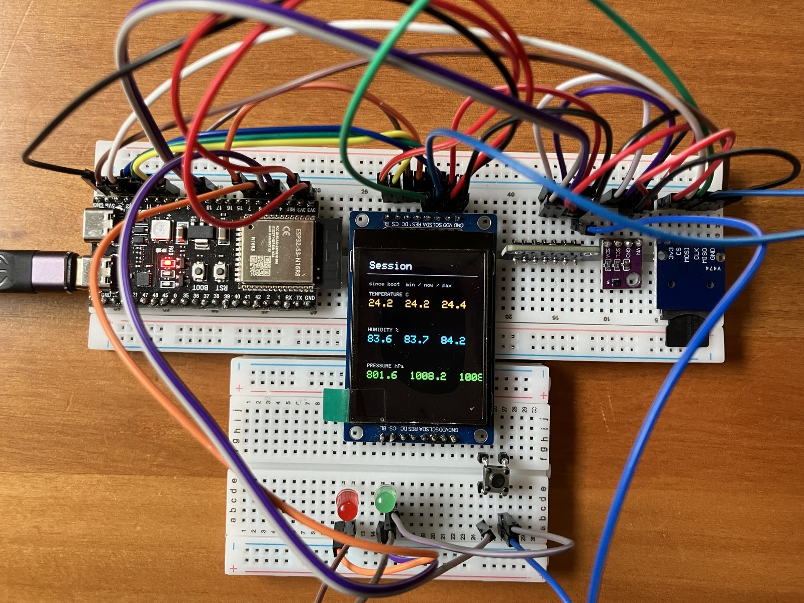
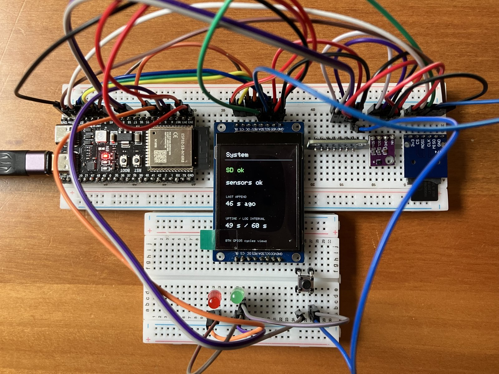

# Phase 9 — TFT views + status LEDs

One **tact** on **GPIO5** cycles the ST7789 through **Now → Session → System → Now**. **Green LED** pulses on each successful SD append; **red LED** stays on for SD/sensor fault. No buzzer. Climate CSV logging from Phase 8 keeps running.



| View | Shows | This bench |
|------|--------|------------|
| **Now** | Live temp / humidity / pressure | default after boot |
| **Session** | min / now / max since boot | first press |
| **System** | SD ok/fail, sensors, last append age, uptime, log interval | second press |



*Now — live readings (same chrome as Phase 7, title **Now**).*



*Session — min / now / max since boot. Serial prints `view=1`.*



*System — SD and sensor health, last append age, uptime / 60 s log interval. Serial prints `view=2`.*

## Firmware

**Changed.** New folder [`firmware/09-views/`](../../firmware/09-views/) · [`src/main.cpp`](../../firmware/09-views/src/main.cpp)

UI redraw: `fillScreen` only when the tact changes view. Live updates paint opaque text over the old digits (no full-panel wipe each second).

## Preconditions

- [Checkpoint 8](08-sd-log.md) SD path working (`SD ready` / `sd append`)
- Phases 2–8 wiring still on
- Unplug USB while seating the button and LEDs

---

## 9.1 Controls wiring

| S3 | Part |
|----|------|
| **GPIO5** | Tact leg A (other leg → **GND**); `INPUT_PULLUP` |
| **GPIO4** | Green LED anode via ~220–1kΩ; cathode → **GND** |
| **GPIO6** | Red LED anode via ~220–1kΩ; cathode → **GND** |
| **GND** | Shared star |

Press = view advance. Green blinks briefly after `sd append`. Red latches while SD or a sensor read is failing.

---

## 9.2 Flash

Stop any serial monitor on COM first.

<div class="run" markdown>

```bash
cd firmware/09-views
pio run -e esp32-s3-n16r8 -t upload --upload-port /dev/ttyACM0
```

```text {.no-copy}
Connected to ESP32-S3 on /dev/ttyACM0:
…
Hard resetting via RTS pin...
========================= [SUCCESS] Took 17.79 seconds =========================
```

</div>

<div class="run" markdown>

```bash
pio device monitor -b 115200 --port /dev/ttyACM0
```

```text {.no-copy}
weather views — phase 9
BTN=5 LED_OK=4 LED_FAULT=6
…
SD ready
UI live — BTN cycles Now/Session/System (partial redraw)
view=0 temp_c=24.12 humidity=83.9 pressure_hpa=1008.20
sd append /climate.csv uptime_ms=1206
view=1
view=2
```

</div>

This bench: boot LEDs green → red → green (self-test + first append). Idle LEDs stay off. Serial `view=0|1|2` tracks Now / Session / System when the tact is pressed.

---

## 9.3 Validate

1. TFT starts on **Now**; each press advances Session → System → Now.
2. Session min/max move after the station has been up a while (or breathe on the SHT40).
3. System shows **SD ok** when the card works; pull CS or the card → **SD FAIL** + red LED.
4. Green LED blinks on append; CSV still grows.

---

## Checkpoint 9

- [x] Tact cycles all three TFT views (photos above)
- [x] Green LED pulses on SD append; red LED self-test OK (idle off)
- [x] Bench photos in `assets/bench-phase9-{now,session,system}.jpg`
- [x] Logged in [lab-log.md](../lab-log.md)

**Stop here until checkpoint passes.**
