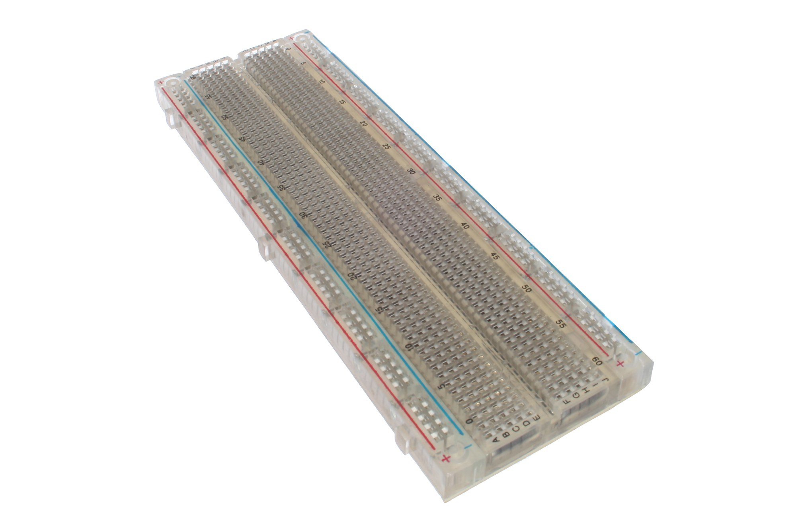

# Prerequisites

This demo is written against **Ubuntu 24.04 LTS**.

## What you need on the desk

| Item | Notes |
|------|-------|
| PC | USB host port that does data |
| ESP32-S3 N16R8 | Dual Type-C DevKitC-class board |
| Climate modules | **SHT40** (temp/humidity) + **BMP390** (pressure), I2C — spares OK |
| Estardyn 2.0″ ST7789 | 240×320, 8-pin (`GND VDD SCK SDA RES DC CS BL`), BL → 3V3 |
| microSD module | 3V3 6-pin TF/SPI mini reader + **FAT32** microSD (see §4) |
| Solderless breadboard | Full-size **830** |
| DuPont jumpers | M–M (and M–F if modules need them) |
| USB-C **data** cable | Charge-only cables never enumerate |

Optional later: tact switch, piezo buzzer, status LED.



Full-size **830** board (this lab). How the holes are already tied together: [Hardware — Breadboard](hardware.md#breadboard).

---

## 1. Base packages

<div class="run" markdown>

```bash
sudo apt-get update
sudo apt-get install -y git curl python3 python3-venv software-properties-common
```

```text {.no-copy}
…
Setting up python3-venv …
Setting up software-properties-common …
```

</div>

`python3-venv` is there because the PlatformIO installer in section 2 builds a virtual environment with the distro Python.

Docs authoring uses a newer Python (**3.14**). Ubuntu 24.04 ships 3.12, so add the [deadsnakes](https://launchpad.net/~deadsnakes/+archive/ubuntu/ppa) PPA first:

<div class="run" markdown>

```bash
sudo add-apt-repository -y ppa:deadsnakes/ppa
sudo apt-get update
sudo apt-get install -y python3.14 python3.14-venv
```

```text {.no-copy}
…
Setting up python3.14 …
Setting up python3.14-venv …
```

</div>

Check:

<div class="run" markdown>

```bash
git --version
/usr/bin/python3.14 --version
curl --version | head -1
```

```text {.no-copy}
git version 2.43.0
Python 3.14.6
curl 8.5.0 (x86_64-pc-linux-gnu) libcurl/8.5.0 OpenSSL/3.0.13 …
```

</div>

---

## 2. PlatformIO CLI

Install PlatformIO Core with the [official installer script](https://docs.platformio.org/en/latest/core/installation/methods/installer-script.html). It creates its own virtual environment under `~/.platformio/penv`. Run it as your normal user, without `sudo`. It uses the distro `python3`, not the 3.14 used for docs.

<div class="run" markdown>

```bash
curl -fsSL -o /tmp/get-platformio.py https://raw.githubusercontent.com/platformio/platformio-core-installer/master/get-platformio.py
python3 /tmp/get-platformio.py
```

```text {.no-copy}
…
```

</div>

`pio` lands in `~/.platformio/penv/bin`, which is not on `PATH` yet. Add it for this shell and for future shells:

<div class="run" markdown>

```bash
export PATH="$HOME/.platformio/penv/bin:$PATH"
echo 'export PATH="$HOME/.platformio/penv/bin:$PATH"' >> ~/.bashrc
command -v pio
```

```text {.no-copy}
/home/johna/.platformio/penv/bin/pio
```

</div>

Confirm:

<div class="run" markdown>

```bash
pio --version
```

```text {.no-copy}
PlatformIO Core, version 6.1.19
```

</div>

If `pio: command not found`, open a new terminal (or run `source ~/.bashrc`) and retry. `esptool`, used in [Phase 0](phases/00-usb-erase.md), is in the same folder at `~/.platformio/penv/bin/esptool`.

---

## 3. USB dialout (once)

From the **repo root**:

<div class="run" markdown>

```bash
sudo ./scripts/setup-linux-usb.sh
```

```text {.no-copy}
Installing udev rules → /etc/udev/rules.d/99-platformio-udev.rules
…
Setup complete.
```

</div>

Log out/in (or reboot), then unplug/replug the board.

---

## 4. Format the microSD (FAT32)

Phase 8 needs a **FAT32** card (FAT16 also works; exFAT is out of scope for v1). Format on the Ubuntu host with a USB card reader **before** you seat the card in the Temu SPI module.

Plug the reader, insert the card, then find the removable disk (this bench: Super Top reader → `/dev/sda`, **not** the NVMe system disk).

<div class="run" markdown>

```bash
lsblk -o NAME,SIZE,TYPE,TRAN,RM,MODEL,FSTYPE,MOUNTPOINT
```

```text {.no-copy}
NAME        SIZE TYPE TRAN   RM MODEL                   FSTYPE MOUNTPOINT
sda         125G disk usb     1 Storage Device
└─sda1      125G part
nvme0n1   931.5G disk nvme    0 Samsung SSD 980 PRO 1TB
├─nvme0n1p1   1G part …                             vfat   /boot/efi
└─nvme0n1p2 …
```

</div>

Confirm **`RM=1`**, **`TRAN=usb`**, and a non-zero **SIZE**. A reader with **SIZE `0B`** means no media — reseat the card. Never format `nvme*` / your root disk.

Unmount if the desktop auto-mounted it, then write a single FAT32 partition labelled `CLIMATE`:

<div class="run" markdown>

```bash
# replace sda if lsblk showed a different letter — double-check RM=1 TRAN=usb
sudo umount /dev/sda1 2>/dev/null || true
sudo wipefs -a /dev/sda
sudo parted -s /dev/sda mklabel msdos
sudo parted -s /dev/sda mkpart primary fat32 1MiB 100%
sudo mkfs.vfat -F 32 -n CLIMATE /dev/sda1
sync
lsblk -o NAME,SIZE,FSTYPE,LABEL /dev/sda
sudo blkid /dev/sda1
```

```text {.no-copy}
NAME    SIZE FSTYPE LABEL
sda     125G
└─sda1  125G vfat   CLIMATE
/dev/sda1: LABEL="CLIMATE" UUID="…" BLOCK_SIZE="512" TYPE="vfat" PARTUUID="…"
```

</div>

Eject safely, then move the card into the **6-pin TF/SPI** reader on the breadboard for [Phase 8](phases/08-sd-log.md).

!!! note "Large cards"
    Hosts often show SDXC as 64–128 G. Linux `mkfs.vfat -F 32` still works. The ESP32 firmware mounts FAT32 via **SdFat**; stick to FAT32 (not exFAT) for this lab.

---

## Checkpoint — prerequisites

- [ ] `git`, Python **3.14**, and `curl` work
- [ ] `pio --version` works without sudo
- [ ] USB dialout / udev done (`setup-linux-usb.sh`)
- [ ] microSD shows **FAT32** / label **CLIMATE** on the host
- [ ] Hardware, breadboard, jumpers, and a data cable are on the desk

**Next:** [Phase 0 — USB erase](phases/00-usb-erase.md)
